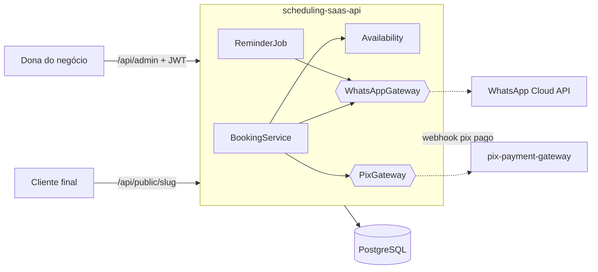

# Scheduling SaaS · API

[](https://github.com/efvieira/scheduling-saas-api/actions/workflows/ci.yml)
[](https://github.com/efvieira/scheduling-saas-api/actions/workflows/cd.yml)


[](LICENSE)

Backend de um **SaaS de agendamento para pequenos negócios** (salões, clínicas, estúdios). Várias empresas usam o mesmo sistema, cada uma com sua página pública de agendamento, sua equipe e sua agenda. O cliente final agenda sem criar conta, recebe confirmação e lembrete por WhatsApp e, nos serviços pré-pagos, paga com Pix.

O frontend em Angular está em [scheduling-saas-web](https://github.com/efvieira/scheduling-saas-web).

### ✨ Destaques

- 🏢 **Multi-tenant**: a empresa do painel vem do JWT, nunca de parâmetro, e a página pública é resolvida pelo `slug`
- 📅 **Motor de disponibilidade** puro e testado: expediente, duração do serviço, agendamentos existentes e horários passados
- 🔒 **Sem overbooking**: lock pessimista por profissional, e quem chega por último recebe `409` com os horários atualizados
- 💬 **Lembretes por WhatsApp** 24h antes, enviados uma única vez (WhatsApp Cloud API ou modo simulado)
- 💸 **Pix para serviços pré-pagos** com idempotência por agendamento, integrável ao [pix-payment-gateway](https://github.com/efvieira/pix-payment-gateway)
- 🔐 **JWT** (Spring Security Resource Server) com perfis `OWNER` e `STAFF`
- 🧵 **Java 25**: records, sealed/pattern matching e virtual threads

### 🛠️ Stack

Java 25 · Spring Boot 4.1 · Spring Security (OAuth2 Resource Server) · Spring Data JPA · Flyway · PostgreSQL · RestClient · springdoc-openapi · JUnit 5 · JaCoCo · Docker · GitHub Actions

## 🏗️ Arquitetura



## 🧠 Decisões técnicas

| Decisão | Por quê |
|---|---|
| Tenant extraído do token | Evita que alguém troque o `businessId` na URL e veja a agenda de outra empresa. |
| Lock pessimista no profissional ao agendar | Dois clientes no mesmo segundo disputando o mesmo horário: um ganha e o outro recebe `409`. Restrição de unicidade não resolve, porque os intervalos podem se sobrepor sem ter o mesmo início. |
| Disponibilidade como função pura | É a regra mais sensível do produto, então é testada sem Spring nem banco. |
| Gateways de WhatsApp e Pix como interfaces | O demo roda sem contas externas; em produção basta configurar `whatsapp.token` e `pix.gateway.url`. |
| Idempotency-Key = id do agendamento | Um retry na criação do Pix não gera duas cobranças para a mesma reserva. |
| Lembrete marcado só após envio | Se o WhatsApp falhar, a próxima execução tenta de novo, e o cliente não recebe duas mensagens. |

## 🚀 Como rodar

```bash
docker compose up -d --build
```

- Swagger: http://localhost:8080/swagger-ui.html
- Empresa demo: `studio-bela`, com login `dona@studiobela.demo` e senha `demo1234`

```bash
curl -s localhost:8080/api/public/studio-bela
curl -s -X POST localhost:8080/api/auth/login -H 'Content-Type: application/json' \
  -d '{"email":"dona@studiobela.demo","password":"demo1234"}'
```

Para ver com a interface, suba o [scheduling-saas-web](https://github.com/efvieira/scheduling-saas-web).

### Testes

```bash
./mvnw verify
```

## 📡 Endpoints

| Método | Rota | Acesso | Descrição |
|---|---|---|---|
| `GET` | `/api/public/{slug}` | público | Empresa, serviços e profissionais |
| `GET` | `/api/public/{slug}/availability` | público | Horários livres |
| `POST` | `/api/public/{slug}/appointments` | público | Agendar |
| `POST` | `/api/public/{slug}/appointments/{id}/cancel` | público | Cancelar (até 2h antes, com o telefone) |
| `POST` | `/api/auth/login` | público | Login do painel (JWT) |
| `GET/POST` | `/api/admin/services` | JWT | Serviços |
| `GET/POST` | `/api/admin/professionals` | JWT | Profissionais e expediente |
| `GET` | `/api/admin/appointments?date=` | JWT | Agenda do dia |
| `PATCH` | `/api/admin/appointments/{id}` | JWT | Confirmar, concluir, falta, cancelar |
| `POST` | `/api/webhooks/pix` | token | Confirmação de pagamento Pix |

## 🗺️ Próximos passos

- [ ] Login via [auth-service](https://github.com/efvieira/auth-service) (trocar o `JwtDecoder` pela chave pública dele)
- [ ] Bloqueios de agenda (férias, feriados)
- [ ] Templates aprovados do WhatsApp para mensagens fora da janela de 24h
- [ ] Demo online

## 🔀 Fluxo de branches e CI/CD

`develop` (padrão) → `release` → `master`, sempre por PR. Detalhes em [CONTRIBUTING.md](CONTRIBUTING.md).

## 📄 Licença

[MIT](LICENSE)
